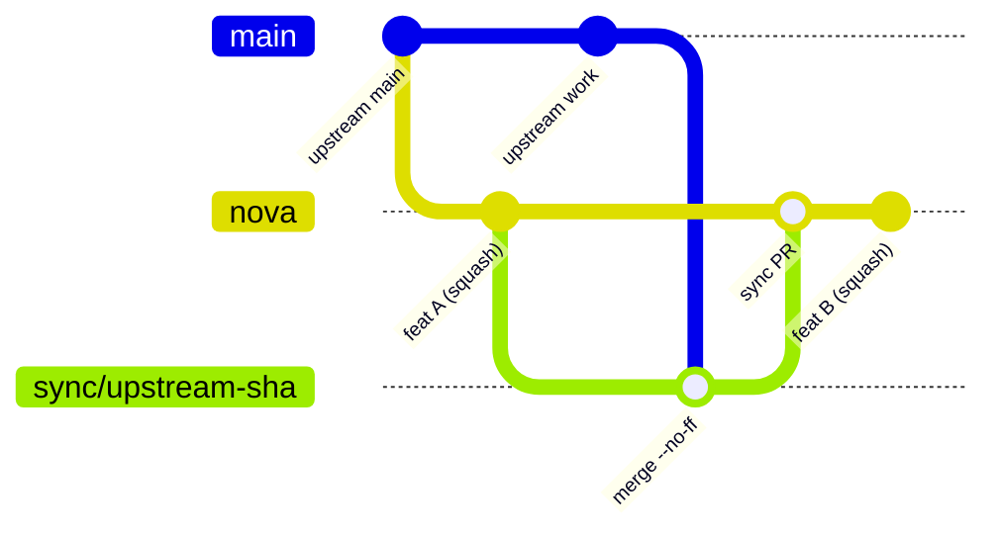

# Nova

Nova is a fork of [zeronsh/zeron](https://github.com/zeronsh/zeron), kept at
[bigx333/zeron](https://github.com/bigx333/zeron). It adds its own features
and follows upstream closely.

## Branch model



- `nova` is the base branch. It starts at upstream `main` 2500e8b (2026-11-02).
- Upstream reaches `nova` by merge only, through a `sync/upstream-<shortsha>`
  branch and a PR to `nova`. Never rebase or force-push `nova`.
- Each Nova feature lands as one squash-merged PR to `nova`.
- Do not push to `main`, `nova`, `fork/*` or older branches. Do not push tags:
  `release.yml` publishes a GitHub Release for every `v*` tag.
- Never open PRs, issues or comments on zeronsh/zeron.

## Syncing upstream

Set up each clone once:

```sh
git remote add upstream https://github.com/zeronsh/zeron.git
git remote set-url --push upstream DISABLED   # nothing can be pushed to zeronsh/zeron
git config remote.upstream.tagOpt --no-tags   # upstream v* tags stay out of local refs
git config rerere.enabled true                # reuse recorded conflict resolutions
```

`origin` must push to bigx333/zeron. The script refuses to run otherwise.

```sh
scripts/nova/sync-upstream.sh --dry-run   # ahead count, commits, touched ledger hooks
scripts/nova/sync-upstream.sh             # merge, push the sync branch, open the PR
```

The script fetches both remotes without tags. It exits 0 when `nova` already
has upstream `main`, or when an open sync PR for that upstream commit exists. A
closed sync PR does not block a new one. Otherwise it creates
`sync/upstream-<shortsha>` from `origin/nova` and merges `upstream/main` with
rerere on. The merge runs in a separate worktree at
`.git/nova-sync/upstream-<shortsha>`, so your checkout stays on its branch. On a
clean merge it pushes only the sync branch, without tags, opens the PR and
removes the worktree. The PR body lists the upstream commits and the ledger hook
files they touch.

On conflict the script stops with the merge still in progress in that worktree
and lists the conflicted files. Resolve them there, commit, and run the script
again to push and open the PR. rerere records each resolution, so the same
conflict resolves itself next time. When rerere resolves every conflict, the
script still stops so you can review the result before you commit.

`scripts/nova/test-sync-upstream.sh` runs the script against throwaway local
repos with a stub `gh`.

## Conflict rules

- Prefer upstream's structure. Take their version, then re-apply the Nova hook
  on top. Use the ledger to find what each hook must do.
- Do not hand-merge `apps/ios/Zeron/Core/Generated/zeron_core.swift`.
  Regenerate it with `scripts/ios/build-core.sh` after the Rust side merges.
- If upstream now does what a Nova feature did, delete the Nova code and its
  ledger row.

## Conventions

- Conventional Commits for commit and PR titles, for example
  `feat(nova): account pool`.
- One squash-merged PR per feature.
- Put fork code in Nova-only files or modules. Keep edits to upstream files to
  small hooks that call into them.
- Each feature PR adds or updates its ledger row.

## Feature ledger

List every upstream file a feature edits in "Upstream hook files", each path in
backticks. The sync script reads that column to flag hooks that upstream
changes touch.

<!-- ledger:start -->
| Feature | PR | Nova-only files | Upstream hook files | Notes |
| --- | --- | --- | --- | --- |
| Zeron skills: `~/.zeron/skills` and `<project>/.zeron/skills` load natively in every harness | #PR | `crates/harness/src/skills/zeron.rs`, `crates/harness/tests/zeron_skills.rs` | `crates/harness/src/skills.rs`, `crates/harness/src/acp/mod.rs`, `crates/harness/src/claude/mod.rs`, `crates/harness/src/codex/mod.rs`, `crates/harness/src/cursor/mod.rs`, `crates/harness/src/opencode/mod.rs`, `crates/harness/src/pi/mod.rs` | Claude via a session `zeron` plugin (`--plugin-dir`, `/zeron:<name>`), Codex via `skills/extraRoots/set`, Pi via `--skill`, OpenCode via inline `skills` paths, ACP agents (fx included) and Cursor via a first-prompt skills list. Muse is not hooked. `skills/zeron.rs` is a child module of `skills.rs` and uses its private scanner. |
<!-- ledger:end -->
