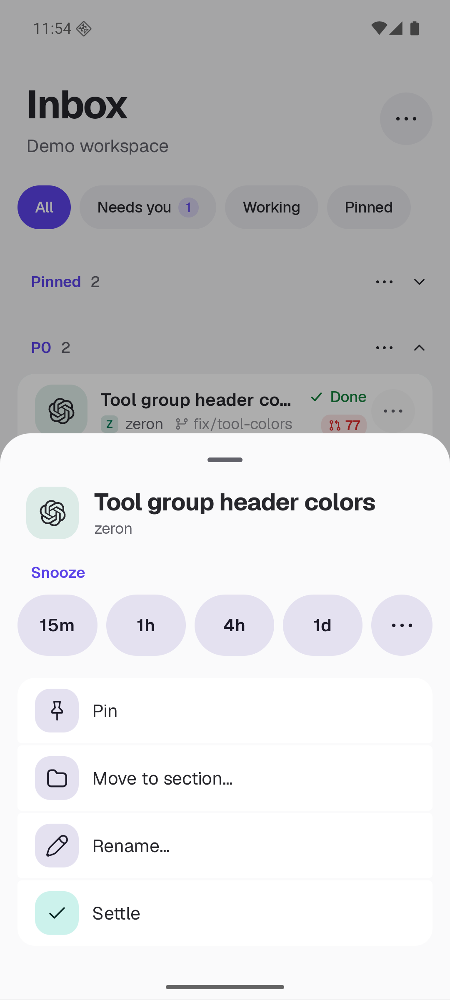
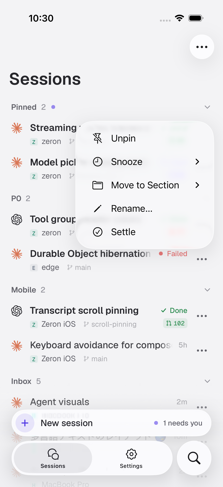

# T3 Mode screenshots

Native captures from the isolated demo workspace. These show the actual app, including touch menus and live thread state.

Snoozing moves a thread to the Snoozed shelf, collapsed by default. Opening or reading leaves it snoozed; sending a message clears the snooze. There is no separate Wake action.

The four presets are 15 minutes, 1 hour, 4 hours and 1 day. A compact ⋯ button expands contextual wake times, followed by a native date-and-time picker. Earlier captures may still show the replaced 1 Week preset or the former custom-duration form.

Some captures show “in 60m”; the current code displays “in 1h” after the rounding fix.

## Desktop

Native fixture captures of the compact snooze card and its inline custom field.

| Screen | Dark | Light |
| --- | --- | --- |
| Presets and wake-time choices | [Open](desktop-t3-quick-snooze-dark.png) | [Open](desktop-t3-quick-snooze-light-opaque.png) |
| Custom duration in place | [Open](desktop-t3-custom-snooze-dark.png) | [Open](desktop-t3-custom-snooze-light-opaque.png) |

## Android

| Screen | Dark | Light |
| --- | --- | --- |
| Four presets and compact ⋯ | — | [Open](android-t3-light-custom-menu.png) |
| Expanded wake-time choices | — | [Open](android-t3-light-snooze-until-options.png) |
| Pick a date | — | [Open](android-t3-light-snooze-date.png) |
| Pick a time | — | [Open](android-t3-light-custom-duration.png) |
| After confirming: Snoozed shelf folded | — | [Open](android-t3-light-until-snoozed-folded.png) |
| Working, Snoozed and Settled folded | [Open](android-t3-dark-shelves-folded.png) | — |
| Snooze presets and Settle button | [Open](android-t3-dark-actions.png) | [Open](android-t3-light-actions.png) |
| Snoozed row | [Open](android-t3-dark-snoozed.png) | [Open](android-t3-light-snoozed.png) |
| Snoozed shelf collapsed | [Open](android-t3-dark-snoozed-folded.png) | — |
| Re-time or settle a snoozed thread | [Open](android-t3-dark-snoozed-actions.png) | [Open](android-t3-light-snoozed-actions.png) |
| Unsettle a settled thread | — | [Open](android-t3-light-unsettle-actions.png) |
| T3 Mode toggle | — | [Open](android-t3-light-mode-menu.png) |
| Default mode | — | [Open](android-default-light.png) |

## iOS

These iOS captures predate the custom picker redesign. Native simulator captures from [the passing screenshot workflow](https://github.com/bigx333/zeron/actions/runs/38677893616).

| Screen | Dark | Light |
| --- | --- | --- |
| Inbox and visible row action buttons | [Open](ios-t3-dark-inbox-folded.png) | [Open](ios-t3-light-inbox-folded.png) |
| Snooze and Settle actions | [Open](ios-t3-dark-row-actions.png) | [Open](ios-t3-light-row-actions.png) |
| Snooze duration submenu | [Open](ios-t3-dark-row-snooze-menu.png) | [Open](ios-t3-light-row-snooze-menu.png) |
| Snoozed and Settled shelves expanded | [Open](ios-t3-dark-shelves-open-scrolled.png) | [Open](ios-t3-light-shelves-open-scrolled.png) |

