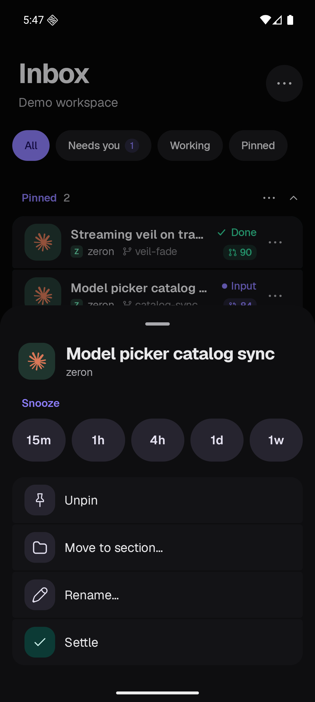

# T3 Mode mobile screenshots

Native captures from the isolated demo workspace. These show the actual app, including touch menus and live thread state.

## Android

| Screen | Dark | Light |
| --- | --- | --- |
| Working, Snoozed and Settled folded | [Open](android-t3-dark-shelves-folded.png) | — |
| Snooze presets and Settle button | [Open](android-t3-dark-actions.png) | [Open](android-t3-light-actions.png) |
| Snoozed row | [Open](android-t3-dark-snoozed.png) | [Open](android-t3-light-snoozed.png) |
| Wake now and Settle | [Open](android-t3-dark-wake-actions.png) | — |
| T3 Mode toggle | — | [Open](android-t3-light-mode-menu.png) |
| Default mode | — | [Open](android-default-light.png) |

## iOS

Native simulator capture is running in [the screenshot workflow](https://github.com/bigx333/zeron/actions/runs/38677893616).
