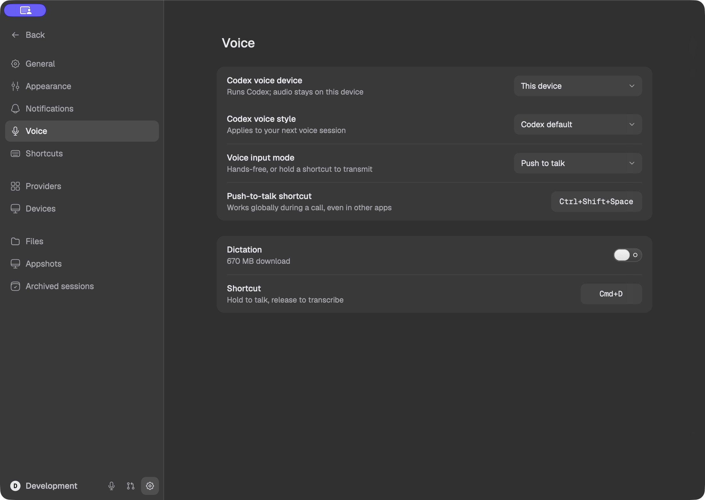
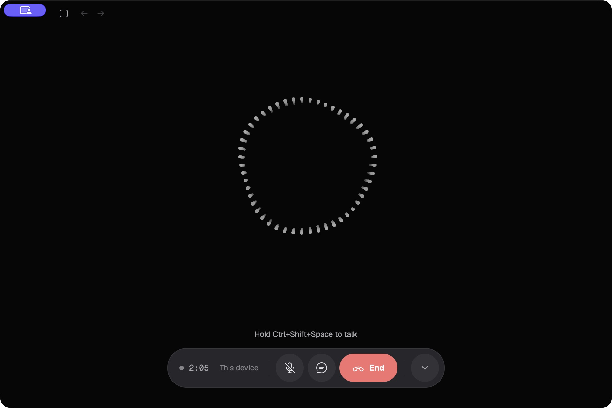
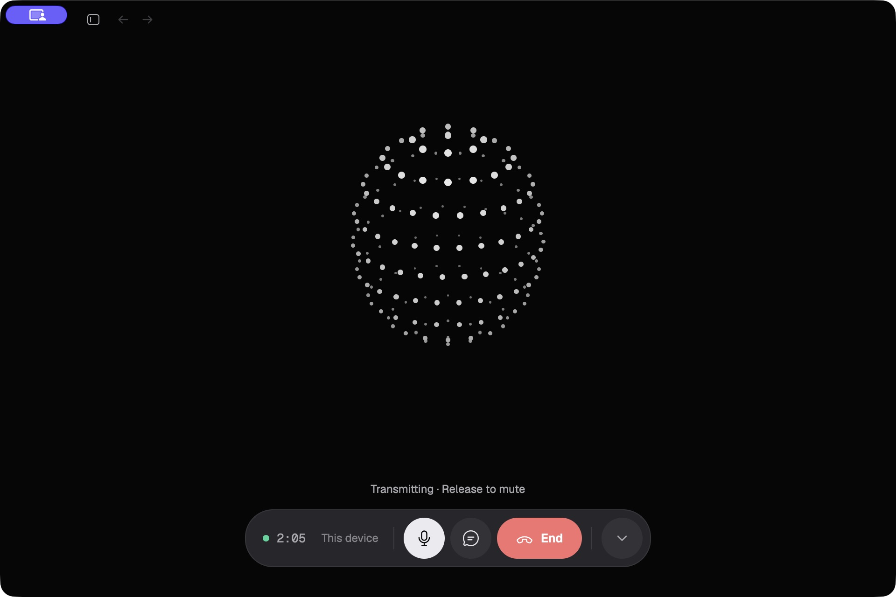
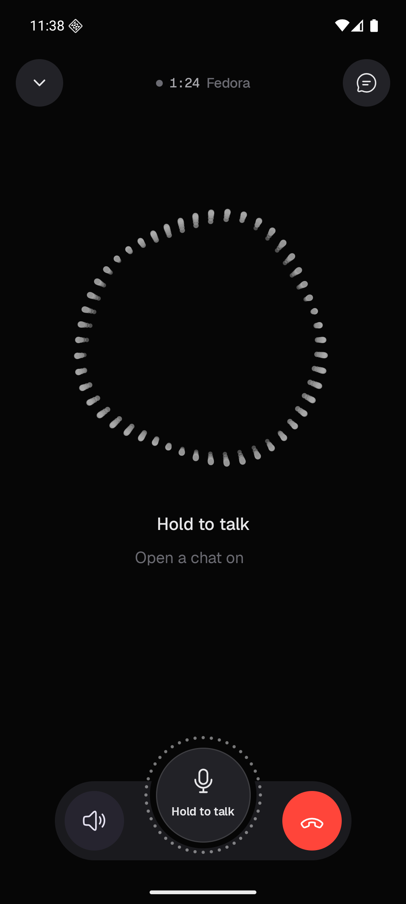
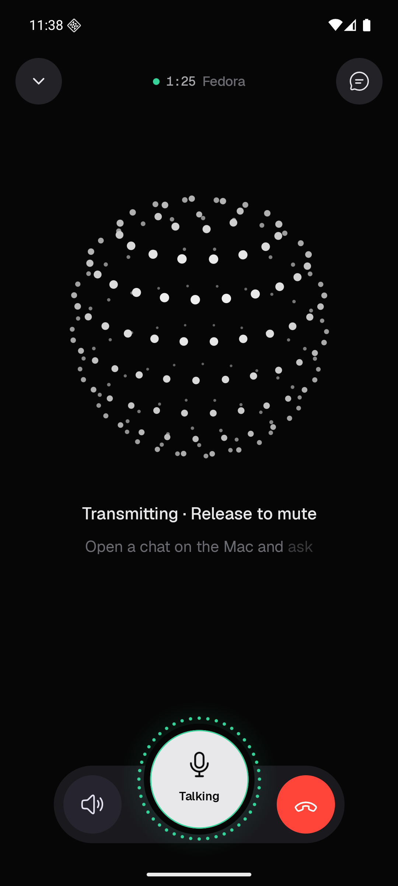
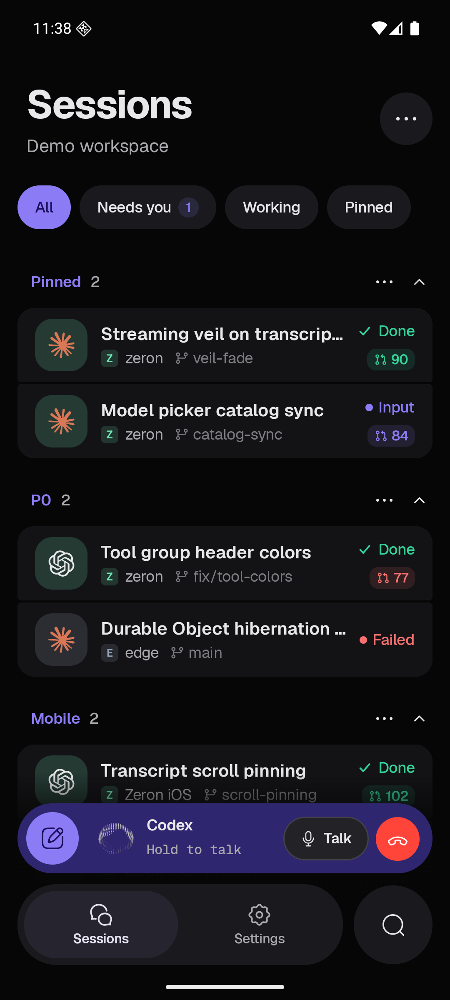
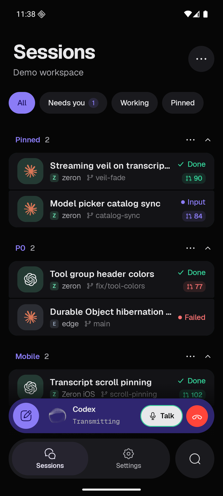
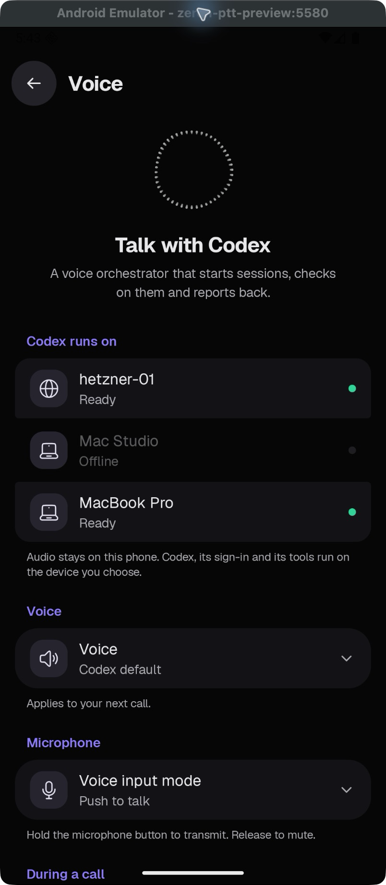

# Push to talk

Voice settings keep **Hands-free** as the default. Select **Push to talk** to
transmit only while holding a talk control. Releasing, cancelling, or leaving a
touch control closes the microphone.

Desktop users can hold the configurable global shortcut or the microphone
button on the call screen. The shortcut setting appears only in push-to-talk
mode. Its default is Ctrl+Shift+Space on macOS and the platform modifier plus
Shift+Space on Linux and Windows. Shortcut recording temporarily suspends the
global talk binding.

On iOS and Android, use the large **Hold to talk** disc or the compact **Talk**
pill. Mobile has no hotkey setting. Moving the app to the background releases
any hold. The disc turns bright with a green microphone meter while transmitting.

## Desktop

| Settings | Waiting | Transmitting |
| --- | --- | --- |
|  |  |  |

## Android

These screenshots use the native call preview, without a live microphone or
relay session.

| Waiting | Transmitting |
| --- | --- |
|  |  |
|  |  |

